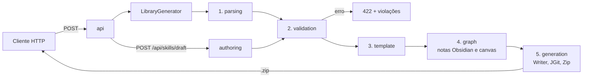

# SkillForge

API em Java/Spring Boot que recebe a descrição de uma biblioteca de **Agent Skills** e devolve um
repositório Git completo em `.zip`, pronto para `git push` no GitHub. Cada repositório gerado também é
um **vault do Obsidian**, com um grafo ligando skills, referências e categorias. Um **assistente de
redação** monta skills novas a partir de perguntas guiadas.

## Arquitetura



Todos os pacotes usam `domain`, que só tem records puros e não depende de Spring.

| Pacote | Responsabilidade |
| --- | --- |
| `domain` | Records imutáveis: `RawSkill`, `Skill`, `Library`, `LintReport`, `LibraryGraph` |
| `parsing` | Separa frontmatter e corpo, lê o YAML, extrai links relativos do Markdown |
| `validation` | `SkillLinter` e uma classe por regra (`validation/rules`), limites de tamanho, proteção de caminhos |
| `template` | Mustache para os arquivos do repositório, catálogo de modelos de skill, `SKILL.md` canônico |
| `authoring` | Assistente de redação: `SkillDraft` → `SKILL.md` + esqueletos + dicas de qualidade |
| `graph` | `LibraryGraphBuilder` (puro) e `ObsidianVaultWriter` (notas, `.obsidian/`, canvas) |
| `generation` | Escrita do repositório, JGit, zip e a orquestração em `LibraryGenerator` |
| `api` | Controllers, DTOs com Bean Validation e erros em `ProblemDetail` |

## Decisões de design

| Decisão | Motivo |
| --- | --- |
| Monólito modular | Domínio pequeno; pacotes separados já organizam |
| Sem banco | O app gera e entrega, não há estado |
| Uma classe por regra de lint (Strategy) | Regra nova = classe nova, testada isolada |
| `RawSkill` antes de `Skill` | Mostra todos os erros de uma vez |
| Mustache | Sem lógica no template, bom para gerar Markdown/YAML |
| `Path` em vez de `File` | Permite Jimfs nos testes |
| Limites em `@ConfigurationProperties` | Formato pode mudar sem recompilar |
| Camada Obsidian separada de `skills/` | O `SKILL.md` continua no formato padrão; o grafo é uma visão por cima, não muda as skills |
| Grafo como modelo puro (`LibraryGraph`) antes de virar arquivo | Testável sem disco e reaproveitado no endpoint de pré-visualização |
| Dicas de qualidade separadas do linter | Linter diz o que está errado; o advisor diz o que pode melhorar, sem bloquear |
| Gerador recebe `LibraryInput`, não o DTO HTTP | Evita ciclo entre `api` e `generation` |
| Frontmatter escrito pelo Jackson, corpo pelo Mustache | Valores com `:` ou aspas continuam sendo YAML válido |

## Como rodar

Pré-requisito: Java 21.

```bash
./mvnw spring-boot:run
```

Ou com Docker:

```bash
docker build -t skillforge .
docker run -p 8080:8080 skillforge
```

Swagger: <http://localhost:8080/swagger-ui.html>

### Gerar uma biblioteca

```bash
curl -X POST localhost:8080/api/libraries/generate \
  -H 'Content-Type: application/json' \
  -d @examples/library-request.json -o out.zip

unzip out.zip && cd minhas-skills
git log --oneline          # um commit: chore: biblioteca gerada pelo SkillForge
bash scripts/validate.sh   # ✓ 3 skill(s) válida(s).
```

### Montar uma skill com o assistente

```bash
curl -X POST localhost:8080/api/skills/draft \
  -H 'Content-Type: application/json' \
  -d @examples/skill-draft.json
```

## Endpoints

| Método | Rota | O que faz |
| --- | --- | --- |
| `GET` | `/api/templates` | Lista os modelos prontos de skill |
| `POST` | `/api/skills/from-template` | Preenche um modelo com name e description |
| `POST` | `/api/skills/lint` | Valida um `SKILL.md` |
| `GET` | `/api/skills/draft/template` | Campos do assistente (pergunta-guia, exemplo, obrigatoriedade) |
| `POST` | `/api/skills/draft` | Monta um `SKILL.md` a partir das respostas guiadas |
| `POST` | `/api/libraries/lint` | Valida a biblioteca inteira |
| `POST` | `/api/libraries/graph` | Nós e arestas do grafo, sem gerar o zip |
| `POST` | `/api/libraries/generate` | Gera o repositório em `.zip` (422 com violações se houver erro) |

## Testes

```bash
./mvnw verify
```

Unitários por regra de lint e de qualidade, parsing, segurança de caminhos, escrita com Jimfs, Git em
pasta temporária real, integração com MockMvc e um teste de contrato que executa o `validate.sh` gerado
(só em Linux e macOS).

## Roadmap (Fase 2)

- Login com GitHub e criação do repositório com push direto.
- Teste de acionamento: prompts de exemplo contra a API do Claude para checar se a `description` faz a
  skill ser escolhida.
- Front com o formulário guiado do assistente, editor e preview do `SKILL.md` e do grafo.
- Assistente de redação com IA: a pessoa descreve a skill em texto livre e o Claude preenche o `SkillDraft`.
